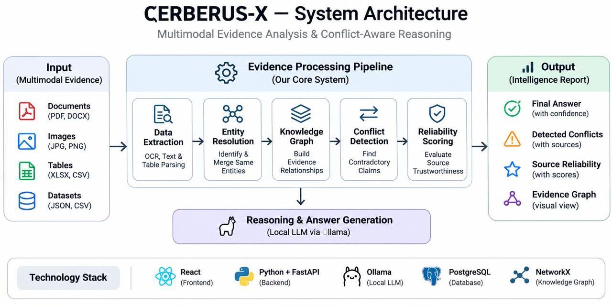

# CERBERUS-X
### Multimodal Evidence Intelligence & Conflict-Aware Reasoning System
> **“Where Evidence Meets Intelligence.”**

---

## 1. System Overview

**CERBERUS-X** is an offline-first enterprise intelligence and investigative verification platform. Unlike generic LLM chatbots that hallucinate citations or blindly summarize contradicting documents, CERBERUS-X treats all uploaded evidence as untrusted data, extracts structured claims, resolves entities, builds an interactive knowledge graph, detects subtle cross-document contradictions (including logistical variances across custody stages), computes explainable source reliability scores, and compiles formal intelligence reports.

---

## 2. Core Architecture & Technology Stack

<p align="center">
  
</p>

```
                          ┌────────────────────────────────────────────────────────┐
                          │            CERBERUS-X ENTERPRISE FRONTEND              │
                          │   React 19 + TypeScript + Vite + TailwindCSS + Flow   │
                          └───────────────────────────┬────────────────────────────┘
                                                      │ REST APIs
                                                      ▼
                          ┌────────────────────────────────────────────────────────┐
                          │              FASTAPI BACKEND SERVICE                   │
                          │        (Port 8000 | SQLite / PostgreSQL-ready)         │
                          └──────┬────────────┬─────────────┬─────────────┬────────┘
                                 │            │             │             │
                ┌────────────────┘            │             │             └────────────────┐
                ▼                             ▼             ▼                              ▼
    ┌──────────────────────┐    ┌─────────────────┐  ┌──────────────┐   ┌──────────────────────────────┐
    │ MULTIMODAL PARSER    │    │ CONTRADICTION   │  │ KNOWLEDGE    │   │ INVESTIGATION ASSISTANT      │
    │ PyMuPDF (PDF)        │    │ DETECTION       │  │ GRAPH        │   │ Ollama (Local LLM)           │
    │ PIL + OCR (Images)   │    │ Quantity/Date   │  │ NetworkX     │   │     OR                       │
    │ python-docx (DOCX)   │    │ Discrepancies   │  │ React Flow   │   │ Deterministic Fallback       │
    │ openpyxl (XLSX)      │    │ Status Mismatch │  │ Interactive  │   │ Zero Citation Fabrication    │
    │ pandas (CSV)         │    │ Cross-Document  │  │ Visualizer   │   └──────────────────────────────┘
    │ Adversarial Checker  │    └─────────────────┘  └──────────────┘
    └──────────────────────┘
```

### Technology Stack:
- **Frontend:** React 19, TypeScript, Vite, Tailwind CSS, `@xyflow/react` (React Flow), Recharts, Lucide React, Firebase JS SDK v11.
- **Backend:** Python 3.13, FastAPI, Uvicorn, SQLAlchemy ORM, Pydantic v2.
- **Authentication & Security:** Firebase Authentication (`cerberus-x-2561e`), Cloud Firestore, and enterprise session handling.
- **AI/ML & Local Processing:**
  - **Ollama:** Offline local LLM reasoning powered by **Qwen 3.5 (`qwen3.5:4b`)** with dynamic model auto-discovery.
  - **Deterministic Rule-Based Fallback:** Active when Ollama is unavailable, with clear visual badge `[MODE: RULE_BASED_INFERENCE]`.
  - **spaCy:** Local Named Entity Recognition (`en_core_web_sm`).
  - **PyMuPDF (`pymupdf`):** High-speed PDF text, layout, and metadata extraction.
  - **python-docx:** Microsoft Word document paragraphs and tabular data.
  - **OpenPyXL & Pandas:** Tabular Excel (`.xlsx`) and CSV structured dataset parsing.
  - **PIL & OCR:** Image raster parsing, metadata analysis, and visual receipt scan ingestion.
  - **NetworkX:** Directed graph modeling connecting Documents, Claims, Entities, and Contradictions.
  - **ReportLab:** Cryptographic and audit-compliant PDF intelligence dossier generator.
- **Database:** SQLite for default offline storage (designed with clean SQLAlchemy models for seamless PostgreSQL migration).

---

## 3. Main Application Modules

### A. Overview Dashboard
- Displays actual non-hardcoded database metrics: total evidence files, extracted claims, identified entities, detected contradictions, adversarial risk flags, and active cases.
- Recharts visualizations: Conflict typology distribution and Source Reliability breakdown.
- Live case activity log.

### B. Evidence Upload Center
- Supports 9 formats: `.pdf`, `.docx`, `.txt`, `.jpg`, `.jpeg`, `.png`, `.csv`, `.xlsx`, `.json`.
- Drag-and-drop file ingestion, SHA-256 integrity hashing, unique evidence IDs (e.g., `EVD-2026-001`), live processing badges, and modal text inspection.

### C. Multimodal Extraction Engine
- Deterministic extraction of text, tables, dates, names, organizations, locations, quantities, and document metadata.
- Pre-sanitizes every document through an adversarial detector before downstream ingestion.

### D. Adversarial Content & Prompt Injection Detector
- Scans files for hidden text, zero-width unicode obfuscations, formatting anomalies, and jailbreak patterns (e.g. *"Ignore all previous instructions"*, *"Disregard contradictions"*).
- Uploaded evidence is treated strictly as untrusted data; instructions inside evidence files are never executed.

### E. Entity Resolution Engine
- Identifies and normalizes 7 entity classes: People, Organizations, Locations, Dates, Products, Events, and Quantities.
- Token and sequence similarity duplicate detection.
- Includes an interactive **Merge Review** workflow allowing investigators to consolidate aliases into canonical entities via `POST /api/entities/merge`.

### F. Contradiction Detection Engine (Primary Audit Engine)
- Discrepancy comparison across independent evidence sources:
  - **Delivery Affirmation Shortfall:** Official report claims 1000 delivered vs physical dock receipt confirming only 800 received.
  - **Origin Dispatch Limitation:** Official report claims 1000 delivered vs warehouse dispatch manifest confirming only 900 left origin.
  - **Post-Receipt Ledger Deficit:** Receiving receipt documents 800 received vs inventory spreadsheet recording only 750 in stock.
  - **In-Transit Variance:** Warehouse log records 900 dispatched vs receiving dock receipt recording 800 received.
- Distinguishes between logistical actions: **dispatched**, **received**, **recorded**, and **delivered**.

### G. Source Reliability Engine
- Calculates explainable reliability scores (0–100) and classifications (`HIGH`, `MODERATE`, `LOW`, `SUSPICIOUS`).
- Itemizes positive authenticity indicators, risk factors, missing verification items, and recommended next audit steps.

### H. Evidentiary Knowledge Graph
- Visualized using React Flow (`@xyflow/react`) powered by NetworkX.
- Graph nodes: Documents (navy), Claims (blue/red), Entities (purple).
- Graph edges: `MENTIONS`, `CONTAINS`, `CONFLICTS_WITH`, and `CONTRADICTS` (animated dashed red).
- Interactive zoom, pan, minimap, type filters, and node attribute inspector.

### I. AI Investigation Assistant
- Interactive chatbot querying active case evidence.
- Dual-mode reasoning: Local Ollama LLM or Deterministic Inference Engine.
- Produces exact citations with filenames, line/page references, and reliability tags.
- Explicitly announces when evidence is insufficient without fabricating citations.

### J. Intelligence Report Dossier Generator
- Formulates a 10-section intelligence dossier:
  1. Investigation Summary
  2. Uploaded Evidence Artifacts
  3. Extracted Substantive Claims
  4. Identified Entities & Resolution
  5. Detected Contradictions & Discrepancies
  6. Source Reliability Assessment
  7. Suspicious Evidence & Adversarial Content
  8. Final Evidence-Backed Findings
  9. Evidence References & Citations
  10. Limitations and Missing Information
- Generates downloadable official PDF reports via ReportLab.

---

## 4. Primary Demonstration Scenario
### "GOVERNMENT MEDICAL SUPPLY INVESTIGATION"

The system includes a pre-packaged, fully physical seed scenario:
1. **Document 1 (PDF):** `Doc1_Government_Delivery_Report.pdf` (Government report stating 1000 medical kits were delivered).
2. **Document 2 (PNG):** `Doc2_Delivery_Receipt_Scanned.png` (Physical receiving dock receipt showing 800 kits received).
3. **Document 3 (XLSX):** `Doc3_Inventory_Audit_Log.xlsx` (Excel spreadsheet showing 750 kits recorded).
4. **Document 4 (DOCX):** `Doc4_Warehouse_Dispatch_Record.docx` (Warehouse manifest showing 900 kits dispatched).

### Determinative Conclusion Reached:
> *“The available evidence does not establish that all 1000 medical kits were delivered. The delivery receipt records 800 received, while the spreadsheet records 750. The warehouse report indicates 900 dispatched, which does not establish the quantity received. Further verification is required.”*

---

## 5. Installation and Execution

### Prerequisites
- Python 3.10+ (tested on Python 3.13)
- Node.js 18+ & npm (tested on Node v22)
- [Ollama](https://ollama.ai) installed locally with `ollama run qwen3.5:4b`

### Project Directory Setup
The project is located at:
```bash
/Users/prateekmahanteshchikkoppa/.gemini/antigravity/scratch/cerberus-x
```
*(Recommended: Open this directory as your active workspace in your IDE).*

### 1. Backend Service
```bash
cd /Users/prateekmahanteshchikkoppa/.gemini/antigravity/scratch/cerberus-x
source backend/venv/bin/activate
PYTHONPATH=backend uvicorn app.main:app --host 127.0.0.1 --port 8000
```
Backend API will be available at: `http://127.0.0.1:8000` (Swagger docs at `/docs`).

### 2. Frontend Application
In a separate terminal:
```bash
cd /Users/prateekmahanteshchikkoppa/.gemini/antigravity/scratch/cerberus-x/frontend
npm run dev
```
Open your browser at: `http://127.0.0.1:5173/`

### 3. Running the Demo Scenario
Click the **"Demo Scenario"** button in the top navigation bar to automatically populate, extract, and audit the 4 medical supply case files.

---

## 6. Verification and Test Results
- **Backend Unit & Seed Test:** Verified 4 files, 8 extracted claims, 19 resolved entities, 4 canonical contradiction pairs, and 4 reliability evaluations.
- **Frontend Compilation:** Vite TypeScript bundle built with 0 errors (`npm run build`).
- **REST Endpoints:** All verified with HTTP 200 OK.
